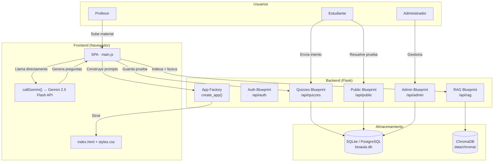
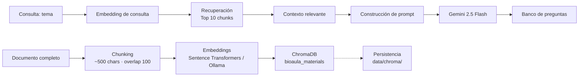
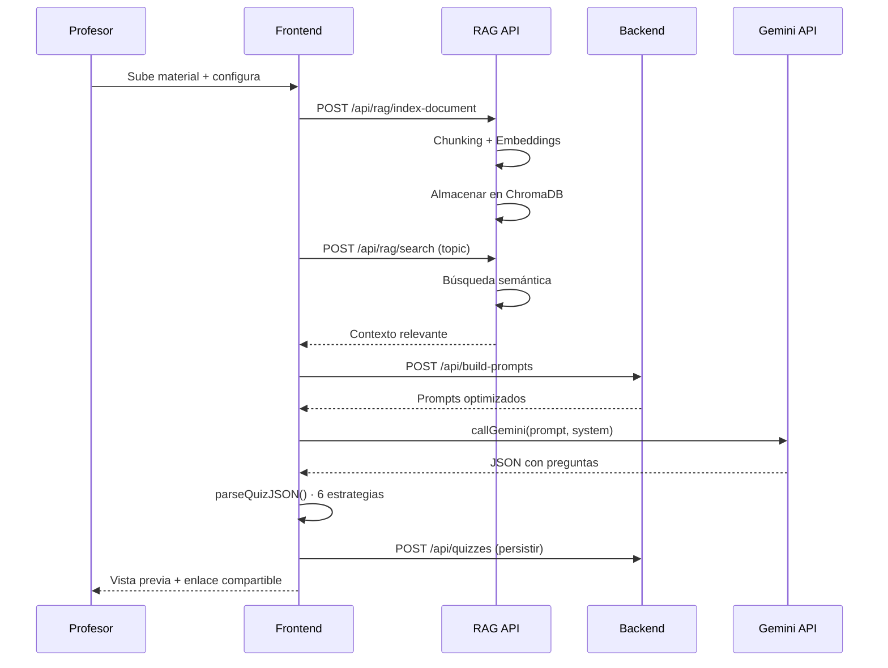

# BioAula

**Plataforma educativa con Inteligencia Artificial para generación automática de evaluaciones, análisis de resultados y gestión académica.**

Los profesores suben material de clase, la IA genera bancos de preguntas únicos para cada estudiante, analiza el desempeño del grupo y produce informes pedagógicos.

---

## Características

### Autenticación y Roles
- Autenticación mediante **JWT** (JSON Web Tokens) con 24 horas de expiración
- Tres roles con permisos diferenciados:
  - **Admin** — gestión de usuarios, dashboard global del sistema
  - **Profesor** — crear pruebas, ver estadísticas, descargar informes
  - **Estudiante** — resolver pruebas asignadas, ver retroalimentación

### Gestión de Usuarios
- Panel administrativo con dashboard de métricas del sistema
- CRUD completo de usuarios (crear, editar, eliminar)
- Validaciones: correo único, contraseña mínima 8 caracteres, roles válidos
- Protección: un admin no puede eliminarse a sí mismo

### Gestión de Pruebas
- Generación automática de bancos de preguntas mediante **Gemini 2.5 Flash**
- Cada estudiante recibe preguntas únicas seleccionadas determinísticamente por su nombre
- Persistencia en base de datos SQLite (preparado para PostgreSQL)
- Compartición mediante enlaces públicos o código QR
- Soporta material de entrada: texto, PDF, DOCX, TXT, imágenes, URLs de YouTube

### Evaluaciones
- Registro automático de intentos de estudiantes
- Deduplicación de resultados por documento de identidad
- Retroalimentación personalizada por estudiante generada por IA
- Material de estudio generado automáticamente para cada tema

### Estadísticas e Informes
- Estadísticas automáticas del grupo: promedio, máximo, mínimo, aprobados
- Mapa de calor por subtemas para identificar áreas débiles
- Recomendaciones pedagógicas generadas por IA para el profesor
- Informes PDF descargables con: portada, tabla de estudiantes, preguntas difíciles

### RAG (Retrieval-Augmented Generation)
- Indexación semántica del material de estudio para reducir el texto enviado a Gemini
- **Chunking** automático del texto en fragmentos de ~500 caracteres con solapamiento
- **Embeddings** generados con Sentence Transformers (`all-MiniLM-L6-v2`) o **Ollama** (`nomic-embed-text`)
- Almacenamiento en **ChromaDB** con persistencia en disco
- Recuperación de los 10 fragmentos más relevantes para cada consulta
- Fallback automático al documento completo si RAG no está disponible

---

## Arquitectura

### Arquitectura General



### Flujo RAG



### Flujo de Generación de Pruebas



---

## Estructura del Proyecto

```
bioaula/
├── app.py                          # Punto de entrada Flask + rutas principales
├── requirements.txt                # Dependencias Python
├── bioaula.db                      # Base de datos SQLite (auto-creada)
│
├── backend/
│   ├── __init__.py                 # Fábrica de aplicación (create_app)
│   ├── config.py                   # Configuración (SECRET_KEY, DB, JWT)
│   ├── extensions.py               # Extensiones Flask (SQLAlchemy, JWT, Bcrypt)
│   ├── public.py                   # Endpoint público de quizzes
│   │
│   ├── auth/                       # Autenticación JWT
│   │   ├── __init__.py
│   │   ├── routes.py               # POST /register, /login, GET /me
│   │   ├── services.py             # Validación de registro/login
│   │   └── decorators.py           # @admin_required
│   │
│   ├── admin/                      # Panel de administración
│   │   ├── __init__.py
│   │   ├── routes.py               # CRUD usuarios + dashboard
│   │   └── services.py             # Validación de datos de usuario
│   │
│   ├── quizzes/                    # Gestión de pruebas
│   │   ├── __init__.py
│   │   ├── routes.py               # CRUD quizzes + submit + reporte PDF
│   │   └── services.py             # Validación de quizzes/intentos
│   │
│   ├── models/
│   │   ├── __init__.py
│   │   ├── user.py                 # Modelo Usuario (usuarios)
│   │   └── quiz.py                 # Modelos Quiz, QuizQuestion, QuizAttempt
│   │
│   ├── rag/                        # Sistema RAG
│   │   ├── __init__.py
│   │   ├── routes.py               # POST /index-document, /search
│   │   ├── chunking.py             # División de texto en fragmentos
│   │   ├── embeddings.py           # Embeddings (Ollama / Sentence Transformers)
│   │   ├── retrieval.py            # Indexación y búsqueda
│   │   └── vector_store.py         # Cliente ChromaDB
│   │
│   └── reports/                    # Generación de informes
│       ├── __init__.py
│       ├── analytics_service.py    # Agregación de datos estadísticos
│       └── pdf_generator.py        # Generación de PDF con ReportLab
│
├── data/
│   └── chroma/                     # Persistencia de ChromaDB
│
├── static/
│   ├── css/
│   │   └── styles.css              # 1159 líneas — tema oscuro, diseño completo
│   │
│   └── js/
│       ├── main.js                 # Punto de entrada, API global window.BioAula
│       ├── state.js                # Estado global + llamada a Gemini
│       ├── ui.js                   # Navegación, toast, utilidades visuales
│       ├── files.js                # Carga de archivos, drag & drop
│       ├── quiz-generator.js       # Generación de pruebas con RAG
│       ├── quiz-player.js          # Flujo del estudiante
│       ├── stats.js                # Estadísticas, informes PDF
│       ├── admin.js                # Panel administrativo
│       ├── auth.js                 # Helpers de autenticación
│       └── permissions.js          # Control de acceso por rol
│
└── templates/
    ├── index.html                  # SPA principal (377 líneas)
    ├── login.html                  # Página de inicio de sesión
    └── register.html               # Página de registro
```

---

## API

### Autenticación (`/api/auth`)

| Método | Endpoint | Auth | Descripción |
|--------|----------|------|-------------|
| `POST` | `/api/auth/register` | — | Registrar usuario (nombre, correo, password, rol) |
| `POST` | `/api/auth/login` | — | Iniciar sesión (correo, password) → token + user |
| `GET` | `/api/auth/me` | JWT | Obtener información del usuario actual |

### Pruebas (`/api/quizzes`)

| Método | Endpoint | Auth | Descripción |
|--------|----------|------|-------------|
| `POST` | `/api/quizzes` | JWT | Crear nueva prueba con preguntas |
| `GET` | `/api/quizzes` | JWT | Listar pruebas (propias o todas si admin) |
| `GET` | `/api/quizzes/:id` | JWT | Obtener prueba con preguntas |
| `POST` | `/api/quizzes/:id/submit` | — | Enviar intento de estudiante |
| `GET` | `/api/quizzes/:id/attempts` | JWT | Listar intentos de una prueba |
| `GET` | `/api/quizzes/:id/report` | JWT | Descargar informe PDF |

### Público (`/api/public`)

| Método | Endpoint | Auth | Descripción |
|--------|----------|------|-------------|
| `GET` | `/api/public/quizzes/:id` | — | Obtener datos públicos de una prueba |

### Administración (`/api/admin`)

| Método | Endpoint | Auth | Descripción |
|--------|----------|------|-------------|
| `GET` | `/api/admin/dashboard` | Admin | Estadísticas del sistema (usuarios, pruebas, intentos) |
| `GET` | `/api/admin/users` | Admin | Listar todos los usuarios |
| `POST` | `/api/admin/users` | Admin | Crear nuevo usuario |
| `PUT` | `/api/admin/users/:id` | Admin | Editar usuario |
| `DELETE` | `/api/admin/users/:id` | Admin | Eliminar usuario (no a sí mismo) |

### RAG (`/api/rag`)

| Método | Endpoint | Auth | Descripción |
|--------|----------|------|-------------|
| `POST` | `/api/rag/index-document` | — | Indexar documento (document_id + text) |
| `POST` | `/api/rag/search` | — | Búsqueda semántica (query + document_id) |

### Utilidades (`app.py`)

| Método | Endpoint | Auth | Descripción |
|--------|----------|------|-------------|
| `POST` | `/api/validate-key` | — | Validar formato de API Key de Gemini |
| `POST` | `/api/parse-file` | — | Extraer texto de archivos (TXT, MD, CSV) |
| `POST` | `/api/build-prompts` | — | Construir prompts para Gemini con material |
| `POST` | `/api/teacher-analysis-prompt` | — | Prompt de análisis pedagógico para profesor |
| `POST` | `/api/student-feedback-prompt` | — | Prompt de retroalimentación para estudiante |

---

## Instalación

### Requisitos
- Python 3.10+
- Node.js (opcional, solo para desarrollo)

### Pasos

```bash


# 1. Crear entorno virtual
python -m venv venv

# 2. Activar entorno virtual
# Windows:
venv\Scripts\activate
# macOS / Linux:
source venv/bin/activate

# 3. Instalar dependencias
pip install -r requirements.txt

# 4. Crear archivo .env desde la plantilla
cp .env.example .env

# 5. Ejecutar suite de pruebas
pytest

# 6. Iniciar el servidor
python app.py

# 7. Abrir en el navegador
# http://localhost:5000
```

### Despliegue con Docker

Para producción o pruebas locales en contenedores:

```bash
# Construir y levantar servicios
docker compose up -d --build

# Ver logs
docker compose logs -f

# Detener
docker compose down
```

### Seguridad y Arquitectura Anti-Fraude

- **Protección de respuestas:** El endpoint público `/api/public/quizzes/<id>` utiliza `to_public_dict()` para no exponer nunca las respuestas correctas ni explicaciones en el frontend antes de la evaluación.
- **Calificación en el servidor:** El backend evalúa cada respuesta contra la base de datos de manera estricta y deduplica intentos por documento de identidad.
- **Control de roles:** La creación de usuarios con rol `admin` está bloqueada en la API pública de registro y reservada exclusivamente para administradores autenticados.
- **Proxy de IA:** Los estudiantes pueden recibir retroalimentación pedagógica personalizada a través del proxy del backend sin necesidad de tener una API key individual de Google AI Studio.

### Configuración de API Key de Gemini

1. Ve a [Google AI Studio](https://aistudio.google.com/apikey)
2. Crea una API Key gratuita (Gemini 2.5 Flash — 1M tokens)
3. Puedes ingresarla en la interfaz de BioAula (se guarda en tu navegador) o definir `GEMINI_API_KEY` en tu archivo `.env` del servidor.

### Configuración de RAG (opcional)

Por defecto, BioAula usa **Sentence Transformers** (`all-MiniLM-L6-v2`) para embeddings con persistencia en **ChromaDB** mediante `upsert` idempotente. Para usar **Ollama**:

```bash
# Instalar Ollama
# https://ollama.com/download

# Descargar modelo de embeddings
ollama pull nomic-embed-text
```

Si Ollama no está disponible, BioAula usa automáticamente Sentence Transformers o el fallback nativo. Si RAG no está activo, el sistema envía el documento completo a Gemini.

---

## Tecnologías

### Backend
| Tecnología | Versión | Uso |
|-----------|---------|-----|
| Python | 3.10+ | Lenguaje principal |
| Flask | 3.0+ | Framework web |
| SQLAlchemy | 3.1+ | ORM y base de datos |
| Flask-JWT-Extended | 4.6+ | Autenticación JWT |
| Flask-Bcrypt | 1.0+ | Hash de contraseñas |
| ReportLab | 4.0+ | Generación de PDF |
| ChromaDB | 1.5+ | Base de datos vectorial |
| Sentence Transformers | 3.0+ | Embeddings (fallback) |
| Ollama | — | Embeddings (preferente) |

### Frontend
| Tecnología | Uso |
|-----------|-----|
| JavaScript (ES6 Modules) | Lógica de aplicación |
| CSS3 (Custom Properties) | Estilos con tema oscuro |
| Gemini 2.5 Flash API | Generación de contenido IA |
| QRCode.js | Generación de códigos QR |

### Base de Datos
| Tecnología | Uso |
|-----------|-----|
| SQLite | Desarrollo (por defecto) |
| PostgreSQL | Producción (configurable vía DATABASE_URL) |
| ChromaDB | Almacenamiento vectorial RAG |

---

## Roadmap

- [ ] **Chat con documentos** — conversación interactiva con el material de estudio usando RAG
- [ ] **Recomendaciones pedagógicas IA** — sugerencias automáticas basadas en patrones de error históricos
- [ ] **Exportación Excel** — descarga de estadísticas y resultados en formato XLSX
- [ ] **Dashboard avanzado** — gráficos interactivos, filtros por fecha, tendencias
- [ ] **Banco de conocimiento por materia** — reutilización de materiales indexados entre pruebas
- [ ] **Usuarios activos** — métricas de actividad por período
- [ ] **Top profesores** — ranking de actividad docente
- [ ] **Crecimiento mensual** — visualización de adopción y uso

---

